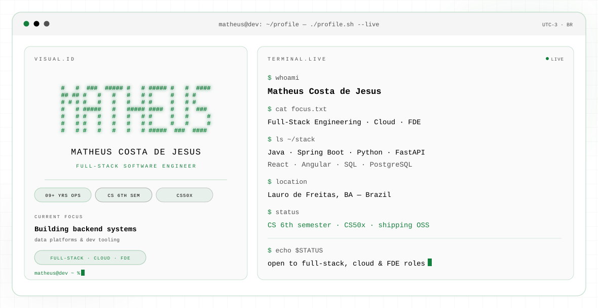
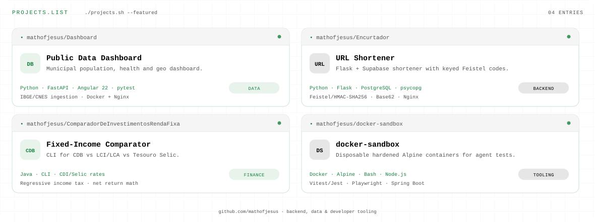

<!-- ===== THEME-AWARE HERO ===== -->
<picture>
  <source media="(prefers-color-scheme: dark)" srcset="https://raw.githubusercontent.com/mathofjesus/mathofjesus/main/assets/hero-dark.svg">
  <source media="(prefers-color-scheme: light)" srcset="https://raw.githubusercontent.com/mathofjesus/mathofjesus/main/assets/hero-light.svg">
  
</picture>

<!-- ===== IDENTITY BADGES ===== -->

&nbsp;

&nbsp;

&nbsp;

&nbsp;

&nbsp;

  

<a href="#english">English</a> · <a href="#portugues">Português</a>

<!-- ===== GITHUB STATS ===== -->

<picture>
  <source media="(prefers-color-scheme: dark)" srcset="https://streak-stats.demolab.com/?user=mathofjesus&hide_border=true&background=000000&stroke=4ADE80&ring=FFFFFF&fire=4ADE80&currStreakLabel=4ADE80&sideLabels=A3A3A3&currStreakNum=FFFFFF&sideNums=FFFFFF&dates=737373&titleColor=4ADE80&card_width=1180" />
  
</picture>

 

<picture>
  <source media="(prefers-color-scheme: dark)" srcset="https://github-readme-stats-sigma-rosy-28.vercel.app/api?username=mathofjesus&show_icons=true&count_private=true&include_all_commits=true&hide_rank=true&hide_border=false&border_color=4ADE80&title_color=4ADE80&icon_color=FFFFFF&text_color=A3A3A3&bg_color=000000&card_width=500" />
  
</picture>
<picture>
  <source media="(prefers-color-scheme: dark)" srcset="https://github-readme-stats-one.vercel.app/api/top-langs/?username=mathofjesus&layout=compact&langs_count=8&hide_border=true&title_color=4ADE80&text_color=A3A3A3&bg_color=000000&card_width=500" />
  
</picture>

Automatic language distribution across all repositories — includes systems and CS50 projects.

<!-- ===== CONTRIBUTION SNAKE ===== -->

<picture>
  <source media="(prefers-color-scheme: dark)" srcset="https://raw.githubusercontent.com/mathofjesus/mathofjesus/output/snake-dark.svg" />
  <source media="(prefers-color-scheme: light)" srcset="https://raw.githubusercontent.com/mathofjesus/mathofjesus/output/snake-light.svg" />
  
</picture>

<!-- ===== ABOUT ===== -->
## `$ whoami`

Computer Science student (6th semester) with **8+ years** of experience in industrial environments, monitoring real-time KPIs and investigating process anomalies down to root cause. I build data and backend solutions with **Python, SQL, and PostgreSQL** — public-data ingestion, offline-first dashboards, and web services with automated tests and Docker. I am looking for opportunities in **data science, data platforms, and applied analytics** at banks, fintechs, and product companies.

<!-- ===== TECH STACK ===== -->
## `$ cat stack.txt`

**Core languages**

  
  
  
  
  
  
  
  

**Backend & APIs**

  
  
  
  
  
  

**Frontend**

  
  
  
  
  
  
  
  

**Data & analysis**

  
  
  
  
  
  

**Cloud & DevOps**

  
  
  
  
  
  
  

**Testing & build**

  
  
  
  
  
  
  
  
  

**Security**

  
  
  
  

<!-- ===== PROJECTS ===== -->
## `$ ./projects --featured`

<picture>
  <source media="(prefers-color-scheme: dark)" srcset="https://raw.githubusercontent.com/mathofjesus/mathofjesus/main/assets/projects-dark.svg">
  <source media="(prefers-color-scheme: light)" srcset="https://raw.githubusercontent.com/mathofjesus/mathofjesus/main/assets/projects-light.svg">
  
</picture>

**Featured:** [Dashboard](https://github.com/mathofjesus/Dashboard) · [Encurtador](https://github.com/mathofjesus/Encurtador) · [Comparador de Investimentos](https://github.com/mathofjesus/ComparadorDeInvestimentosRendaFixa) · [docker-sandbox](https://github.com/mathofjesus/docker-sandbox)

| Repository | Stack | What it does |
|------------|-------|--------------|
| [Dashboard](https://github.com/mathofjesus/Dashboard) | Python · FastAPI · Angular · pytest/Vitest | Offline-first dashboard for Brazilian population, healthcare facilities and municipal geographies. Ingests IBGE and CNES data while preserving the original CLI, JSON API and processed-file contracts. Docker + Nginx deployment. |
| [Encurtador](https://github.com/mathofjesus/Encurtador) | Python · Flask · PostgreSQL/Supabase · Docker | URL shortener with non-sequential 7-character codes from a keyed Feistel permutation (HMAC-SHA256) encoded in Base62. O(1) resolution by primary key, 30-day TTL, and cleanup through pg_cron or GitHub Actions. |
| [Comparador de Investimentos](https://github.com/mathofjesus/ComparadorDeInvestimentosRendaFixa) | Java · CLI | Compares CDB, LCI/LCA and Tesouro Selic net returns from amount, term and CDI percentage, applying Brazil's regressive income-tax table. A personal decision aid, not investment advice. |
| [docker-sandbox](https://github.com/mathofjesus/docker-sandbox) | Docker · Alpine · Bash/Node.js | Agent skill that runs TypeScript and Java/Spring test suites in hardened, disposable containers (cap-drop, read-only rootfs, non-root user). Installer auto-detects Claude Code, Cursor, Codex and Hermes. |

<b>Other repositories</b>

| Repository | Stack | Description |
|------------|-------|-------------|
| [GFP](https://github.com/mathofjesus/gestor-de-financas-pessoais) | Java · Spring Boot · PostgreSQL | Full-stack personal finance platform with JWT, RBAC, Flyway migrations, and CI/CD |
| [SecureLens](https://github.com/mathofjesus/SecureLens) | C++ · C | Dependency vulnerability analysis with an ML model built from scratch |
| [Portfolio](https://github.com/mathofjesus/Portfolio) | Next.js · TypeScript · Tailwind | Personal website and project showcase |
| [visual-query-builder](https://github.com/mathofjesus/visual-query-builder) | TypeScript · SQL | Build SQL queries through a visual interface |
| [CS50x](https://github.com/mathofjesus/CS50x) | C · Python · SQL | Harvard CS50x problem sets and final project |
| [memory-game](https://github.com/mathofjesus/memory-game) | TypeScript · React Native | Expo + Jest memory game |
| [notificador-de-precos](https://github.com/mathofjesus/notificador-de-precos) | Java | Price monitoring service |
| [Sistema_de_Bibliotecas](https://github.com/mathofjesus/Sistema_de_Bibliotecas) | Java | Academic library system |
| [Zoo](https://github.com/mathofjesus/Zoo) | Java | Zoo management system |
| [Agenda-de-Contatos](https://github.com/mathofjesus/Agenda-de-Contatos) | HTML | Contact agenda project |
| [EstruturasDeControle](https://github.com/mathofjesus/EstruturasDeControle) | Java | Programming exercises |

<!-- ===== EDUCATION ===== -->
## `$ cat education.txt`

- **B.Sc. in Computer Science** — Descomplica (expected graduation: December 2027), 6th semester
- **Certifications** — Object-Oriented Developer · DB Developer · Programming Basics · Computer Architecture and Organization (Descomplica)
- **Languages** — Portuguese native · English intermediate (B1)
- **8+ years** as a Machine Operator at M. Dias Branco — real-time KPI monitoring, process anomaly investigation, technical documentation, operator training, and safety compliance

<!-- ===== CAREER ===== -->
## `$ cat goals.txt`

**Data Science · Data Platforms · Applied Analytics · Backend Engineering**

Target: banks, fintechs, product companies, and data teams. I am especially interested in Python, SQL, public-data ingestion, pipelines, dashboards, automated tests, and production troubleshooting.

<!-- ===== PORTUGUESE ===== -->

---

## 🇧🇷 Versão em português

### `$ whoami`

Estudante do 6º semestre de Ciência da Computação, com **mais de 8 anos** de experiência em ambientes industriais, monitorando KPIs em tempo real e investigando anomalias de processo. Construo soluções de dados e backend com **Python, SQL e PostgreSQL** — ingestão de dados públicos, dashboards offline-first e serviços web com testes automatizados e Docker. Busco oportunidades em **ciência de dados, plataformas de dados e análise aplicada** em bancos, fintechs e empresas de produto.

### `$ ./projects --featured`

**Destaques:** [Dashboard](https://github.com/mathofjesus/Dashboard) · [Encurtador](https://github.com/mathofjesus/Encurtador) · [Comparador de Investimentos](https://github.com/mathofjesus/ComparadorDeInvestimentosRendaFixa) · [docker-sandbox](https://github.com/mathofjesus/docker-sandbox)

| Repositório | Stack | O que faz |
|-------------|-------|-----------|
| [Dashboard](https://github.com/mathofjesus/Dashboard) | Python · FastAPI · Angular · pytest/Vitest | Dashboard offline-first de população, estabelecimentos de saúde e malhas por município brasileiro. Ingere dados do IBGE e do CNES preservando o contrato original de CLI, API JSON e arquivos processados. Deploy com Docker + Nginx. |
| [Encurtador](https://github.com/mathofjesus/Encurtador) | Python · Flask · PostgreSQL/Supabase · Docker | Encurtador de URLs com códigos não sequenciais de 7 caracteres, gerados por permutação de Feistel com chave (HMAC-SHA256) e codificação Base62. Resolução O(1) pela chave primária, TTL de 30 dias e expurgo via pg_cron ou GitHub Actions. |
| [Comparador de Investimentos](https://github.com/mathofjesus/ComparadorDeInvestimentosRendaFixa) | Java · CLI | Compara o rendimento líquido de CDB, LCI/LCA e Tesouro Selic a partir de valor, prazo e percentual do CDI, aplicando a tabela regressiva de IR. Ferramenta pessoal de apoio à decisão, não é recomendação de investimento. |
| [docker-sandbox](https://github.com/mathofjesus/docker-sandbox) | Docker · Alpine · Bash/Node.js | Agent skill que executa suítes TypeScript e backends Java/Spring em contêineres descartáveis e endurecidos (cap-drop, rootfs somente leitura, usuário não-root). O instalador detecta Claude Code, Cursor, Codex e Hermes. |

### `$ cat formacao.txt`

- **Bacharelado em Ciência da Computação** — Descomplica (conclusão prevista: dezembro de 2027), 6º semestre
- **Certificações** — Object-Oriented Developer · DB Developer · Programming Basics · Arquitetura e Organização de Computadores (Descomplica)
- **Idiomas** — Português nativo · Inglês intermediário (B1)
- **Mais de 8 anos** como Operador de Máquinas na M. Dias Branco — monitoramento de KPIs em tempo real, investigação de anomalias de processo, documentação técnica, treinamento de operadores e conformidade de segurança

### `$ cat objetivos.txt`

**Ciência de Dados · Plataformas de Dados · Análise Aplicada · Engenharia Backend**

Objetivo: bancos, fintechs, empresas de produto e times de dados. Tenho interesse especial em Python, SQL, ingestão de dados públicos, pipelines, dashboards, testes automatizados e troubleshooting de produção.

<!-- ===== CONTACT ===== -->
## `$ contact --social`

&nbsp;

&nbsp;

&nbsp;

<!-- ===== FOOTER ===== -->

  From data model to UI — building software that holds up in production.

